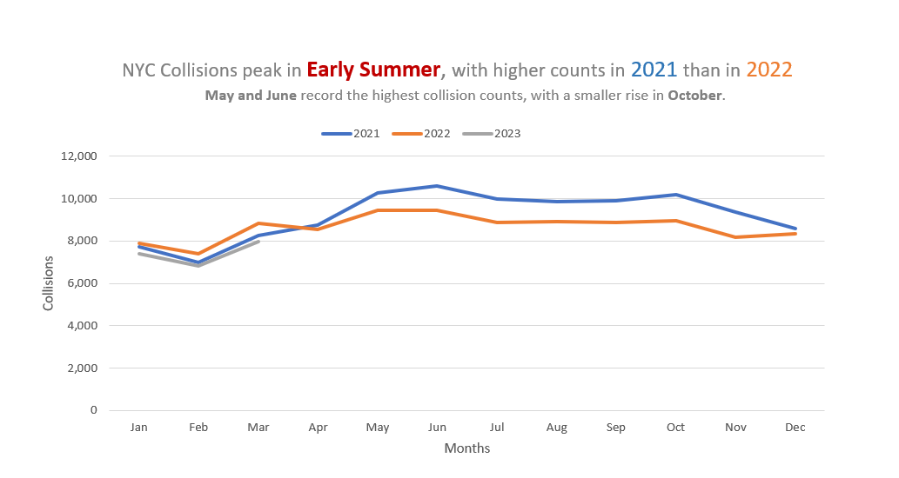
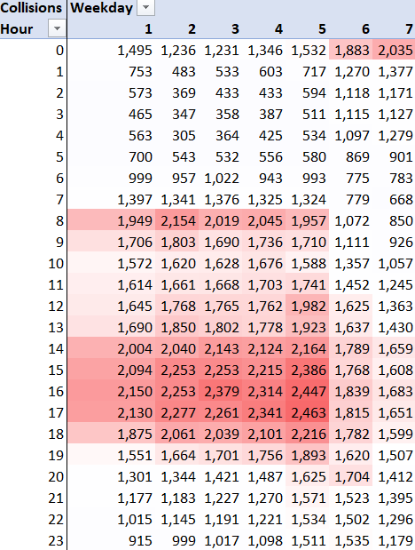
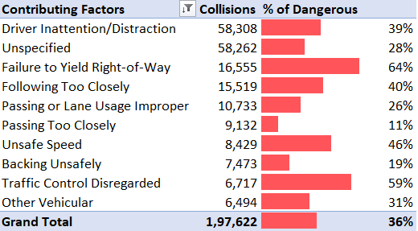

# NYC Traffic Safety Analysis
> Analyzed NYC traffic collision data in Excel to reveal when collisions peak across months, weekdays, and hours, and which contributing factors are most common and most likely to cause injury or death.

 

## 📊 View Excel Project
[View the Excel Analysis](.xlsx)
 

## 💼 Business Problem

The New York City Police Department's Analytics Team has been tasked with analyzing traffic accident data from January 1st, 2021 to April 9th, 2023 as part of the city's Public Safety Initiative program. The goal is to identify patterns and trends that can help the NYPD prevent future accidents.

To support this, the analysis answers three questions:

1. **When** do collisions peak during the year? (seasonal patterns)
2. **When** during the week are collisions most concentrated? (weekday and hour hotspots)
3. **Why** do collisions happen, and which causes most often lead to injury or
   death? (contributing factors)

 

## 📊 Key Findings
### 1️⃣Seasonal Patterns

  

*   Collision counts rise sharply in spring, reaching approximately 10,289 in May and peaking at 10,608 in June 2021. This suggests that collision activity increases during late spring and early summer.

*   Collisions rise again in October 2021 to approximately 10,204, creating a smaller autumn peak before counts decline in November. Collision counts generally fall toward the end of the year, with a noticeable drop in November 2021 to approximately 9,375.

*   From May through December, 2021 generally records more collisions than 2022. The gap is especially noticeable in May and November, suggesting that monthly collision patterns differed between the two years.

### 2️⃣Weekly Trends

  

*   On weekdays, collisions rise around 8 AM during the morning commute and peak again between 3 PM and 5 PM as people head home from work.

*   Friday records the highest hourly count, with 2,463 collisions at 5 PM, possibly due to rush-hour traffic combined with the start of weekend activities.

*   On weekends, the pattern shifts to later hours, with collisions increasing into the evening and peaking around midnight. Sunday records 2,035 collisions at midnight, possibly reflecting late-night social activities and travel.

### 3️⃣Contributing Causes

  

*   Driver Inattention/Distraction is the most frequently reported contributing factor, with 58,308 collisions, closely followed by 58,262 classified as Unspecified. 

*   However, the factors with the highest percentages of dangerous outcomes are different. Failure to Yield Right-of-Way leads at 64%, followed by Traffic Control Disregarded at 59% and Unsafe Speed at 46%, compared with the overall 36%. 

*   This shows that the most frequently reported factors are not necessarily those with the highest percentage of dangerous outcomes.

 

## 🔧Tools
Microsoft Excel (PivotTables, WEEKDAY/HOUR functions, conditional formatting, line charts) 

 

## 📂Dataset
NYPD motor vehicle collision data (Maven Analytics), January 1, 2021 to April 9, 2023

 

## ⚙️ Methodology

#### Objective 1: Seasonal Patterns
1. Counted `Collision ID` by year and month using a PivotTable
2. Excluded April 2023, since the data ends on April 9th and the month is incomplete
3. Plotted a line chart with each year as a separate line

#### Objective 2: Weekly Trends
1. Extracted weekday with `WEEKDAY` and hour with `HOUR` from the Date and Time columns
2. Counted `Collision ID` by weekday and hour
3. Built a heatmap using a white-white-red 3-color scale so the most dangerous periods stand out

#### Objective 3: Contributing Factors
1. Counted `Collision ID` by contributing factor and kept the top 10, sorted descending
2. Calculated `% of Dangerous Collisions = collisions with an injury or fatality ÷ total collisions` for that factor
3. Added data bars to the percentage column

 

## 🔮Future Enhancements
1. Build an interactive dashboard in Power BI or Tableau
2. Add street-level analysis to pinpoint high-risk locations, since location data is already in the dataset

 

## 💙Acknowledgments
Completed as part of the Traffic Safety Analysis guided project in the Maven Analytics Excel Specialist path. Thanks to Maven Analytics for the structured guidance and dataset.
